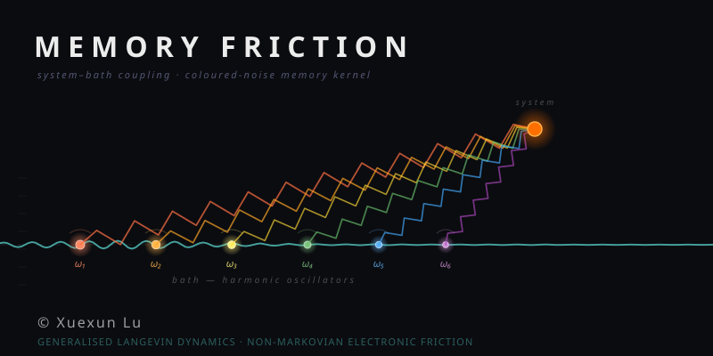

<p align="center">
  
</p>

<p align="center">
  <a href="https://github.com/maurergroup/memory-friction-paper_figures/actions/workflows/CI.yml"></a>
  <a href="https://julialang.org/"></a>
  <a href="./LICENSE"></a>
  <a href="#"></a>
  <a href="#"></a>
</p>

## About

When an adsorbate (e.g., a NO molecule on Au(111)) moves across a metal surface, its kinetic energy dissipates into the electronic degrees of freedom of the substrate. In the non-adiabatic regime — where the electronic response is not slaved instantaneously to the nuclear motion — this dissipation carries a **memory** of the adsorbate's past trajectory, encoded in a time-nonlocal friction kernel. This repository provides figure data presented in our manuscript for studying such memory-driven electronic friction within the framework of the Generalised Langevin Equation (GLE).


## Status

> **This repository is under active development.** The plotting script is being developed. The current codebase is a scaffolded [DrWatson](https://juliadynamics.github.io/DrWatson.jl/stable/) project with CI infrastructure in place. Physics modules are being added as the associated study progresses.

A manuscript is in preparation. Check the [issues](https://github.com/maurergroup/memory-friction-paper_figures/issues) for current progress and planned milestones.

## Repository Structure

```
.
├── _research/          Research notes, derivations, and theoretical background
├── assets/             assets for this repository (e.g., logos, icons, etc.)
├── figure_data/        Figure data to reproduce the figures in the paper
├── plots/              Generated figures
├── scripts/            Simulation and analysis scripts
├── src/                Reusable source modules (under development)
├── test/               Test suite (runtests.jl)
└── .github/workflows/  CI via GitHub Actions
```

## Installation

```bash
git clone https://github.com/maurergroup/memory-friction-paper_figures.git
cd memory-friction-paper_figures
julia --project=. -e 'using Pkg; Pkg.instantiate()'
```

The project uses [DrWatson](https://juliadynamics.github.io/DrWatson.jl/stable/) for reproducible workflow management and consistent path handling.

**Requirements:** Julia ≥ 1.11.

## Getting Started

Verify the installation:

```bash
julia --project=. -e 'using DrWatson; @quickactivate "memory-friction-paper_figures"'
```

Run the test suite:

```bash
julia --project=. test/runtests.jl
```

Continuous integration runs the test suite on every push and pull request via GitHub Actions.

## Related Work

The theoretical treatment of electronic friction and memory-dependent friction in adsorbate systems draws on several foundational contributions spanning non-adiabatic mixed quantum-classical methods, nonequilibrium statistical mechanics, and numerical methods for stochastic differential equations. Below we highlight ten key references directly relevant to the Generalised Langevin framework for memory-driven electronic friction studied in this work.

1. **Brandbyge et al.** (*1995*), [*Phys. Rev. B*](https://doi.org/10.1103/PhysRevB.52.6042), **52**, 6042.  
   Newns-Anderson Hamiltonian based memory electronic friction.

2. **Head-Gordon & Tully** (*1995*), [*J. Chem. Phys.*](https://doi.org/10.1063/1.469915), **103**, 10137.  
   Introduced the molecular dynamics with electronic friction (MDEF) method.

3. **Zwanzig** (*2001*), [*Nonequilibrium Statistical Mechanics*](https://doi.org/10.1093/oso/9780195140187.001.0001), Oxford University Press.  
   Classic book introducing the Mori–Zwanzig projection-operator formalism that rigorously derives the Generalised Langevin Equation with a non-Markovian memory kernel from microscopic Hamiltonian dynamics.

4. **Haug & Jauho** (*2008*), [*Quantum Kinetics in Transport and Optics of Semiconductors*](https://doi.org/10.1007/978-3-540-73564-9), 2nd ed., Springer, Springer Series in Solid-State Sciences, Vol. 123.  
   Develops the nonequilibrium Green's function (Keldysh) formalism that provides the microscopic quantum-statistical foundation for deriving non-Markovian memory kernels and quantum kinetic equations with history-dependent dissipation.

5. **Lü et al.** (*2012*), [*Phys. Rev. B*](https://doi.org/10.1103/PhysRevB.85.245444), **85**, 245444.  

6. **Pavliotis** (*2014*), [*Stochastic Processes and Applications*](https://doi.org/10.1007/978-1-4939-1323-7), Springer, Texts in Applied Mathematics.  
   Provides a rigorous mathematical treatment of stochastic processes, including the Fokker–Planck equation and numerical methods for SDEs, which underpin the integration of the GLE with coloured noise.

7. **Dou, Nitzan, & Subotnik** (*2015*), [*J. Chem. Phys.*](https://doi.org/10.1063/1.4927237), **143**, 054103.  

8. **Askerka, Maurer, Batista, & Tully** (*2016*), [*Phys. Rev. Lett.*](https://doi.org/10.1103/PhysRevLett.116.217601), **116**, 217601.  


9. **Maurer, Askerka, Batista, & Tully** (*2016*), [*Phys. Rev. B*](https://doi.org/10.1103/PhysRevB.94.115432), **94**, 115432.  
    Milestoning and first work demonstrates the ab initio electronic structure-level electronic friction of molecules on metal surfaces dynamics with Nonadiabatic vibrational relaxation

10. **Gardner, Habershon, & Maurer** (*2023*), [*J. Phys. Chem. C*](https://doi.org/10.1021/acs.jpcc.3c03591), **127**, 15257.  
    Benchmarked several mixed quantum-classical methods (MDEF, Ehrenfest, IESH, BCME) against scattering models for molecules on metal surfaces. Provides a comprehensive introduction and comparison of different non-adiabatic dynamics methods for further reading and reference.

These ten studies collectively establish the theoretical and computational context in which the present work on memory-driven electronic friction via Generalised Langevin Dynamics is situated.

## Citation

If you use this code in your research, please cite the associated paper:

```bibtex
@article{lu_memory_friction_2026,
  title   = {Memory dependent electronic friction for molecular scattering from surfaces},
  author  = {Lu, Xuexun and Hertl, Nils and Box, Connor L and Maurer, Reinhard J},
  journal = {In preparation},
  year    = {2026}
}
```

A DOI will be added upon publication.

## License

This project is licensed under the MIT License. See [LICENSE](./LICENSE) for details.

Copyright © 2026 Xuexun Lu.

---

<div align="center">

[**Xuexun Lu (Hokseon)**](https://louhokseson.github.io)<br>
*PhD Candidate*

[The Maurer Computational Surface Science Group](https://maurergroup.github.io)

University of Warwick, UK 

[louhokseson@gmail.com](mailto:louhokseson@gmail.com)

</div>
